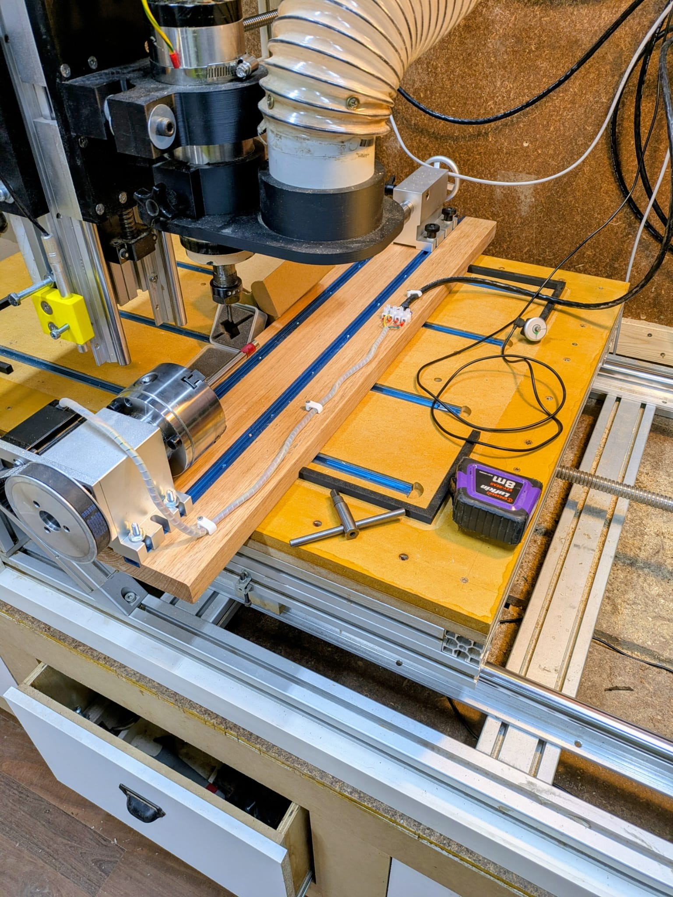
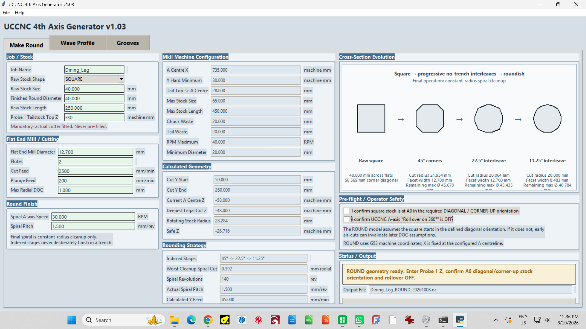
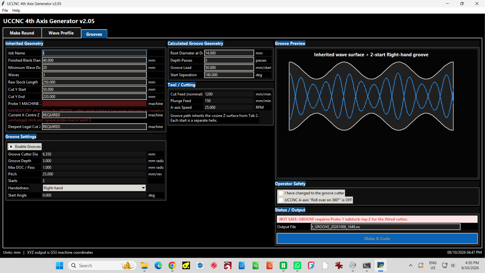
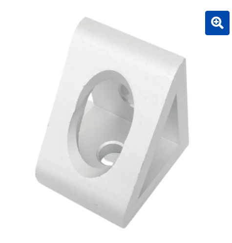

# FourthAxisCNC

**Target machine: my DIY CC Router**

Current documented build: **v2.23**

# 1. Purpose

This program is a machine-specific G-code generator for hobby rotary
machining. It was developed around a fixed-spindle CNC router with a
rotary A axis mounted parallel to machine Y. The design priority is
predictable, inspectable toolpaths with explicit operator choices and
conservative collision avoidance rather than generic simultaneous
multi-axis CAM.

The current workflow supports four operations: ROUND, WAVE, TAPER and
GROOVE. Each operation can generate a standalone UCCNC program so cutter
changes and probing can be performed deliberately between stages.

## Project images

Current machine setup and a few development snapshots:

| Early ROUND development | GROOVE development |
|---|---|
|  |  |

*Some screenshots are historical development snapshots and therefore show older version numbers or superseded fields.*

# 2. What the program currently does

| **Operation** | **Purpose**                                              | **Current strategy**                                                                                                          |
|---------------|----------------------------------------------------------|-------------------------------------------------------------------------------------------------------------------------------|
| ROUND         | Convert square or round stock to a finished cylinder     | Indexed no-trench roughing stages followed by a constant-radius spiral cleanup.                                               |
| WAVE          | Machine a cosine-style radial profile along Y            | Complete 360-degree roughing rings at Y stations, followed by a compensated ball-nose finishing spiral.                       |
| TAPER         | Machine a linear taper between two diameters             | Thin-end-first indexed roughing rings with cutter-footprint protection, then one continuous A+Y+Z finishing spiral.           |
| GROOVE        | Cut one or more helical grooves into an existing profile | Operator explicitly selects ROUND, WAVE or TAPER as the parent surface; multi-pass groove depth and handedness are supported. |

# 3. Important machine assumptions

The values below are defaults for the current build and must not be
treated as universal machine settings.

The most recent physical calibration moved A centre X to 778.70 mm,
established a usable rotary Y minimum of 1.0 mm, and replaced awkward
direct 40120 probing with a spoilboard-based 40 mm Probe 1 workflow.

| **Parameter**                 | **Current value** | **Meaning**                                                                                         |
|-------------------------------|-------------------|-----------------------------------------------------------------------------------------------------|
| A centre X                    | 778.70 mm         | Calibrated machine-X centreline of the rotary axis.                                                 |
| Chuck face machine Y          | -70.0 mm          | Chuck face lies 70 mm before machine Y0.                                                            |
| Maximum machine Y             | 600.0 mm          | Hard upper Y limit used by the generator.                                                           |
| Maximum square stock          | 80.0 mm           | Maximum configured square stock size.                                                               |
| Maximum physical stock length | 700.0 mm          | Largest physical blank supported by the current fixture.                                            |
| Chuck waste                   | 20.0 mm           | Nominal protected material at the chuck end.                                                        |
| Tail waste                    | 20.0 mm           | Nominal protected material at the tail end.                                                         |
| A soft-limit magnitude        | 3,600,000 deg     | Matches the verified UCCNC A-axis soft-limit configuration.                                         |
| Minimum finished diameter     | 20.0 mm           | Global minimum allowed finished/root diameter.                                                      |
| Maximum A speed               | 40 RPM            | Global software cap used for rotary cutting calculations.                                           |
| Minimum machine Y             | 1.0 mm            | Hard lower Y limit used for generated rotary motion; Y0 itself triggers UCCNC soft-limit rejection. |
| Probe 1 block height          | 40.0 mm           | Single-wire touch block placed on the spoilboard for cutter-specific Z probing.                     |
| Spoilboard to 40120 top       | 4.862 mm          | Measured vertical step from spoilboard top to the 40120 rotary-bed top.                             |
| 40120 top to A centre         | 65.0 mm           | Known rotary centre height above the 40120 bed.                                                     |
| Raw Probe 1 to A centre       | +29.862 mm        | Net correction applied to the raw G53 Probe 1 contact reading.                                      |

# 4. Probe 1 and A-centre reference

Probe 1 is used with the actual fitted cutter. From v2.23 onward the
40.000 mm single-wire Probe 1 block is placed on the spoilboard, where
it remains easy to reach even when rotary stock obscures the 40120 bed.
The operator enters the raw negative G53 machine-Z value shown
immediately after probing. Do not manually subtract the block thickness.

A centre machine Z = raw Probe 1 Z - 40.000 + 4.862 + 65.000 = raw Probe
1 Z + 29.862 mm

The probe conversion uses three fixed dimensions: the 40.000 mm Probe 1
block thickness, the measured 4.862 mm rise from spoilboard to 40120
top, and the 65.000 mm A-centre height above the 40120. Because the
actual cutter performs the touch, cutter stick-out is automatically
included. The old direct 40120-top probing workflow is no longer the
normal operating method.

# 5. Coordinate and phase conventions

- XYZ output is generated in G53 machine coordinates.

- The rotary axis is called A throughout the program even though it is
  physically parallel to Y.

- UCCNC A-axis rollover on 360 degrees must be OFF.

- The original physical A0 orientation is preserved as the phase
  reference for downstream operations.

- For square stock, ROUND assumes the stock starts at A0 in the required
  original diagonal/corner-up orientation.

- WAVE is designed to end at the original A0 physical phase so later
  operations can use a known angular reference.

# 6. Typical workflow

## 6.1 ROUND

- Enter job name, raw stock shape/size, finished diameter, physical
  stock length and the requested machine-Y cut maximum.

- Place the 40 mm Probe 1 block on the spoilboard, probe it with the
  fitted ROUND cutter, and enter the raw negative G53 machine-Z reading
  exactly as shown. Do not subtract 40 mm yourself.

- For square stock, confirm the original corner-up A0 orientation.

- Confirm A-axis rollover is OFF.

- Generate and run the ROUND program.

## 6.2 WAVE

- ROUND geometry is inherited.

- Fit a ball-nose cutter. WAVE cutter diameter/flute count initially
  follow ROUND but can be edited independently.

- Re-probe the 40 mm Probe 1 block on the spoilboard with the actual
  WAVE cutter and enter the raw G53 Z reading.

- Choose wave count, minimum diameter, roughing DOC, finish allowance
  and cutting parameters.

- Generate WAVE only after the geometry and cutter-curvature checks
  pass.

## 6.3 TAPER

- TAPER is locked out when WAVE count is non-zero.

- Enter start diameter, end diameter and taper Y start/end.

- Probe the 40 mm Probe 1 block on the spoilboard with the actual TAPER
  cutter and enter the raw G53 Z reading.

- Both taper diameters must remain at or above the configured minimum
  finished diameter.

- TAPER roughs from the thin end toward the thick end using indexed
  rings, then performs a single finishing spiral.

## 6.4 GROOVE

- Explicitly select the physical parent profile: ROUND, WAVE or TAPER.
  There is no auto-detection.

- The selected source must pass its own validation before GROOVE is
  enabled.

- Fit the groove cutter, probe the 40 mm Probe 1 block on the
  spoilboard, and enter the raw G53 Z reading.

- Choose cutter diameter, groove depth, max DOC/pass, pitch, number of
  starts, handedness and start angle.

- The groove cutter centre is pulled inward from each parent-profile Y
  boundary to keep its footprint away from untouched stock.

# 7. Safety and validation philosophy

The program deliberately refuses to generate G-code when machine
geometry or operator inputs are inconsistent. Important checks include:

- Physical stock length versus chuck-face position, tail waste and
  requested Cut Y Max.

- Hard machine-Y range: Y1.0 to Y600.0. Y0 is physically reachable but
  is not emitted because UCCNC rejects motion exactly on the configured
  soft-limit boundary.

- Minimum allowed finished/root diameter.

- Maximum A RPM and A-axis accumulated travel limit.

- ROUND no-trench cutter geometry and residual cleanup limit.

- WAVE cutter size versus minimum profile curvature.

- TAPER/WAVE mutual exclusion.

- GROOVE source validity and root diameter along the selected parent
  surface.

- GROOVE cutter-footprint setback from parent Y boundaries.

These checks do not replace an operator dry run, visual inspection or
machine-specific setup verification.

# 8. GROOVE source selection

GROOVE never decides for the operator which surface exists on the
workpiece. The base profile is selected explicitly as ROUND, WAVE or
TAPER. This is intentional: stale GUI values must not silently choose a
machining model.

# 9. Output

- Default output directory is currently C:\UCCNC.

- Each stage generates a standalone .nc program.

- Filenames include job name, operation and timestamp.

- Generated headers include key machine and job geometry to make later
  inspection easier.

# 10. Current development status

v2.23 is the current development build. ROUND and WAVE retain their
established machining strategies, while TAPER and GROOVE-on-TAPER remain
newer development areas. Machine calibration now uses A_CENTER_X =
778.70 mm, Y_MACHINE_MIN = 1.0 mm and the spoilboard-based Probe 1
conversion described above. The first real cuts after a code or
calibration change should be dry-run or air-cut above the work where
practical.

# 11. Known limitations / backlog

- No saved job recipe/provenance file yet. Returning to a physical part
  later requires the operator to re-enter geometry that matches the
  actual workpiece.

- A practical lower floor for cutter diameter has not yet been enforced.

- Curved/spherical profile support ("ball on a stick") is on the
  backlog.

- TAPER is intentionally a practical fixed-spindle woodworking taper,
  not a general five-axis surface engine.

- Publishing cleanup, portability and more generic machine configuration
  are still to be done before treating the project as a general-purpose
  release.

# 12. Before adapting this to another machine

Do not copy the machine constants blindly. Re-measure the rotary
centreline, chuck-face relationship, usable Y range, Probe 1 block
thickness, spoilboard-to-rotary-bed step, A-centre height above the
rotary bed, stock envelope, A-axis speed and soft limits. The code is
intentionally explicit about machine geometry because incorrect
assumptions can create collisions or leave significant radial stock
behind.

## Repository contents

- `src/uccnc_4th_axis_generator_V2.23.py` - current Python source.
- `DESIGN_NOTES.md` - machining strategy and design rationale.
- `CHANGELOG.md` - major development milestones.
- `docs/` - DOCX copies of the README and design notes.
- `LICENSE` - MIT licence.

## Important

This is machine-specific experimental CNC software. Review the configured machine constants, dry-run new toolpaths, and verify clearances on your own machine before cutting.
